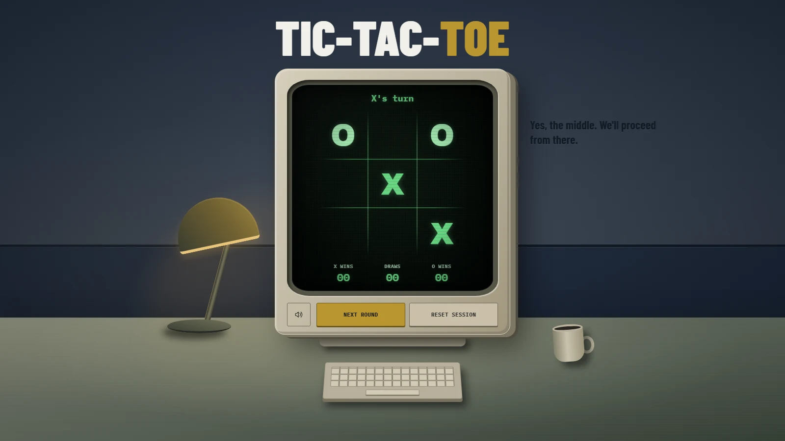
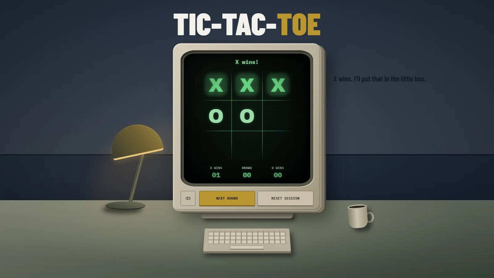

<div align="center">

# Tic-Tac-Toe

A familiar game. A narrator with opinions.

**[Play the game →](https://tictactoeparable.vercel.app)**

React · Next.js · TypeScript · Tailwind CSS · shadcn/ui

</div>



Two players, one device, and a narrator who notices when you stop cooperating. Play a round, repeat a strategy, click the scenery, or do absolutely nothing for a while.

- **Reactive narration** — original dialogue responds to tactics, habits, pauses, and distractions.
- **A desk you can explore** — a CSS-built CRT scene with interactive props and synthesized sound.
- **Made to fit** — responsive layouts, keyboard controls, reduced-motion support, and a sound toggle.

<details>
<summary>One more round</summary>



</details>

## Run locally

Use Node.js 22.6+ and npm. No API keys or backend setup.

```sh
npm ci
npm run dev
```

Open [localhost:3000](http://localhost:3000). Scores and narrator memory last until you reload; **Next round** keeps them, and **Reset session** clears them.

<details>
<summary>Development & deployment</summary>

```sh
npm test
npm run typecheck
npm run build
```

Game rules, narration, and sound live in `src/lib`; UI components in `src/components`; scene styling in `src/app/scene.css`.

Hosted on Vercel. After linking your checkout with `npx vercel link`, deploy with `npx vercel --prod`. GitHub automatic deployments are not connected yet.

On PowerShell, use `npm.cmd` / `npx.cmd` if script execution policy blocks the commands.

</details>

Inspired by *The Stanley Parable*'s dry narration and atmosphere, with original dialogue and CSS scenery. Bundled [Barlow Condensed](https://github.com/google/fonts/tree/main/ofl/barlowcondensed) and [IBM Plex Mono](https://github.com/google/fonts/tree/main/ofl/ibmplexmono); their licenses are in [`public/fonts`](public/fonts).
